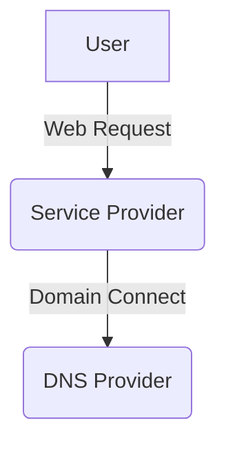

# Seamless possibilities

Seamless is a service related to Domain Connect. Its value proposition is to
make dealing with Domain Connect easier for providers, more trustworthy, and
more accountable.

The simplest way to express what Domain Connect does is that it allows Service
Providers to update DNS content on DNS Providers' systems on behalf of Users.
Updates are authorized by the User and technically implemented by the Domain
Connect protocol.

The Domain Connect protocol is implemented using a bunch of text and JSON data
in DNS TXT records and template files in the
[GitHub Templates](https://github.com/Domain-Connect/Templates) repository.

Unarguably, managing template onboarding has become unsustainable. One only
needs to look at the
[Templates Growth Over Time](https://stats.domainconnect.org/) statistics.
Seeing that there are hundreds of new templates monthly does not tell the whole
story. Each of these templates requires technical scrutiny and a DNS Provider
decision on whether the template can be supported. This results in a lot of
duplicated effort across DNS Providers and frustrating downstream adaptation
support for Service Providers.

# How Seamless could help

Using GitHub as template storage needs to stop. The Seamless Project should
provide working code for a distributed data management model. This is where
Sami Kerola's technical architecture opinions come into play, meaning the rest
of this page is debatable.

## Canonical Service Provider implementation

Ideally, Service Providers should be able to run a Docker image that
implements querying whether a domain supports Domain Connect, and the ability
to apply a template with required variables to a DNS Provider's API.

The Service Provider Docker Service (SPDS) should also have an interactive web
interface for debugging and web developer query format generation. The
interactive web interface could start by 1) giving a domain 2) selecting from
a-z templates the one you want to apply 3) filling in variables 4) showing the
URI for the SPDC call that invokes applying that template.

Preliminary code notes for the above are in the
[serviceProvider](https://github.com/seamless-connect/service/tree/main/serviceProvider)
directory in the seamless repository. Notably, the service interacts with
static signing keys and template files. A production-quality implementation
would pull secrets from secure storage, such as Vault, and templates would be
handled either by Kubernetes ConfigMaps or some other infrastructure-as-code
method.

PK> this is useful, but my current experience shows that the provider
are pretty good at implementing this part and in most cases they do it
fully in front-end. All protocol elements are possible these days - DNS
TXT query with DoH, build the link. Only the signature requires some backend
function to deal with the private key.

That said, the SPDC needs more than a few technical features. See
[Seamless Service](./kerolasa-todo.md) in the TODO file and the seamless
repository.

## Canonical DNS Provider implementation

Once the canonical Service Provider service exists, it is reasonable to
implement a DNS Provider. A lot of technical design elements should be shared
between both implementations, for example logging, OpenTracing, and template
update routines.

Every DNS Provider can be assumed to be unique. The canonical implementation
should use standard DNS building blocks and implement updates using existing
technology. In essence, the DNS Provider code, in Go terms, needs to have
interfaces for authenticating users, confirming that the domain is updatable
on the DNS Provider's servers, and actually updating the DNS by invoking some
sort of API.

An example service could use a dummy OAuth, which means the demo service should
come with minimal account registration, domain onboarding, and a DNS web
management view to see the content of demo domains.

The point of building a standards-compliant DNS Provider demo setup is to
enable Service Providers to test and reproduce updates in a sandbox.

Real DNS Providers need code that is structured for overriding
provider-specific details with local interface implementations.

PK> For DNS providers we could have 2 integration patterns: either
OAuth integration with their API, where Seamless would blend in
white-label front-end, or a containarised microservice, which
a provider would be able to integrate themselves.
I don't believe these days we could expect one software module
in a given programming language or old-style os-level library would
be something people would expect and use. I may be wrong of course.
Last option could be an OS-level binary - however this is also something
I doubt people are doing this days - spawning processes is expensive
and socket-level communications somehow almost a forgotten pattern.
These are my assumptions however without talking to anyone really.

## All parties need Update Accounting

If and when DNS changes break something, the question is always the same: what
happened? Answering that is a high-priority matter. All canonical Domain
Connect software should log

1. Timestamp
2. OpenTracing ID
3. Provider ID and Service ID
4. Where the request came from
5. Response code of the request
6. Affected DNS records

Points 1-4 should be self-explanatory.

The response code should inform whether the update completed successfully, or
failed and why. The response should also tell whether a multi-part update
required a rollback.

Affected DNS records must tell what was deleted and added, if anything. This
data field must never be used for other information, such as that due to a
record conflict the update could not be performed and 'here' is the conflicting
record. These delete/add entries can be trivially converted to an nsupdate
script, which means the order of the entries matters.

PK> Do I read it right as a standardised integration interface,
not that we aim for multi-party observability or tracing, do we?

## How Seamless could smooth things out

The Seamless Project should provide canonical implementations. Beyond that,
the project could also offer running support services. The services could, if
not even should, offer

1. Service Provider template validation
2. SPDS hosting
3. Update transaction accounting
4. Multi DNS Provider apply coordination

Okay, nice list, but what do these mean? Let me answer using separate titles
for each.

### Service Provider template validation

The Seamless Project should have a DNS Provider setup that allows reserving a
namespace for a Service Provider to apply changes and confirm that Domain
Connect is implemented correctly. There is no need for multiple domains;
separate Service Providers can and will have subdomains where the delegation is
a 16-byte-long alphanumeric random string. These subdomains are kept for 14
days and then deleted automatically.

When a Service Provider wants to onboard a template, the workflow is as
follows.

1. The Service Provider writes a template JSON file.
2. The Service Provider implementation will serve a copy of the template to the
   DNS Provider.
3. The Seamless DNS Provider will receive the template and take a SHA-256
   checksum of it.
   1. If the template is unknown, it will be declared not-tested.
   2. Known templates have completed one or more validation steps.

PK> we need to be careful which design we would like to have at this step.
Providing template with each request is likely sub optimal on processing side
so a pre-provisioning of a template might be a reasonable step.
We likely need to take care about lifecycle of the template - so that for example
templates not used for a period X would be deprovisioned.

4. To mark a template known, Seamless DNS will add a TXT record
   1. version.serviceId.providerId.seamlessdns-verify.net.
   2. The content of the TXT record is the SHA-256 of the template data.

PK> Do we need such complicated design? It might be enough
for Seamless to create a signature over a canonical form of the template,
which can be injected into the template itself as a vendor metadata?
I use this method in the signed editor links.
Seamless would only need to publish it's jwks at a well known place.
The validation and the signature would only need some reasonable validity,
so that such signature won't have endless lifetime. Revocation
might be also a future concern.

5. The same name with HINFO contains a validation-status magic string. The
   string encodes whether the Service Provider has confirmed by applying the
   template that it works when applied to the Seamless DNS validation domain.
   The magic string confirms:
   1. The template conforms to the standard.
   2. Public key signature validation works.
   3. OAuth works.
   4. The logo URL contains an image file.
   5. And so on

PK> one item missing: identity verification. I think it is of a value to confirm
that the service provider is who they pretend to be by making verification
of control of their service provider id (domain).

PK> I think we can even go further in the conformance testing.
The DNS provider is highly interested that the service provider
is implementing the protocol right. This is even more important
these days when the software is less written by humans
and machines sometimes go utterly wrong in their assumptions.
I think there shall be an implementation conformance test
harness that the service provider has to pass before they
become a rubber stamp on their template (or provider).

This allows deprecation of the GitHub templates in favour of Service Providers
sending the template to the DNS Provider on request. At the time of applying,
the Service Provider will send the SHA-256 checksum of the template to the DNS
Provider. If the DNS Provider already has the template in its cache, it can be
applied without further checking.

PK> see above - doing it on the fly might be expensive on processing
side. I see however some benefits of this design indeed - the need to
persist the template would cease to exist with this setup - theoretically
allowing for a full front-end side implementation by the dns provider.
URL length limit might be of concern. We shall be able to keep it within
8k octets otherwise wild error scenarios might happen

When a Service Provider asks to apply an unknown template, its contents need
to be transported to the DNS Provider. The DNS Provider can then check whether
the Seamless project knows about the template. If the checksum matches, the
Service Provider has at least made it known. And if the HINFO values do not
cause concern, the template can be cached and applied by the DNS Provider.

### SPDS hosting

The canonical Service Provider implementation can be served on behalf of
others. This does require setting up an authentication and authorisation
schema, in which the hosting provider will

1. Have accounts that authenticate using WebAuthn.
2. An account is part of a group that lists the providerIds the account has
   permission to work with.
3. Templates can be uploaded to a providerId scope.
4. For syncPubKeyDomain validation, SPDS hosting has automatic key generation
   and a button to rotate the key.

PK> good idea. Here we shall however consider what GoDaddy guy Scott said,
not to concentrate too many keys in one pocket, so that Seamless would not
appear to be a valuable target for attack.
For consideration if the service provider would not hold their keys on their
own and sign the requests. I will leave it open for now - as I am not 100%
convinced it would serve for a safer internet.

### Update transaction accounting

The 'All parties need Update Accounting' section already touched on logging
needs. The Seamless Project should provide a service that SPDS hosting uses
natively and that allows standalone Service and DNS Providers to send logs.

In order to see what happened, one needs a Seamless Service account, which
allows Service Providers to see transactions about their updates. DNS
Providers will need a view of the transactions concerning their service.
Seeing the status of someone else's services must not be possible.

The point of this service is to provide insight into what happened and when, by
a system that can be trusted by different parties. The implementation of the
logging could be as simple as OpenTelemetry collection.

### Multi DNS Provider apply coordination

Service Providers that need to align multiple DNS Providers should have the
means to do setups like this. This type of setup needs a well-tested update
rollback feature to ensure that half-applied changes are not left hanging
around. Do not consider multi-provider support before transaction accounting
is most definitely working.

Notice that a rollback that causes a rollback is the stuff of nightmares. Use
an update stack for keeping track of state.

PK> when would we need something like this? The only use case I think of is
DNS transfer - otherwise typically one domain has only one home.
